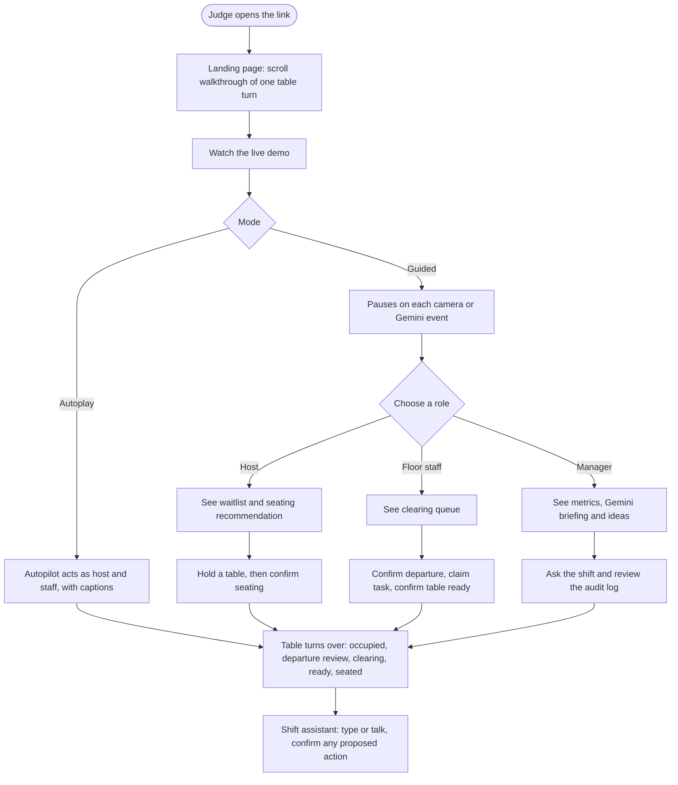
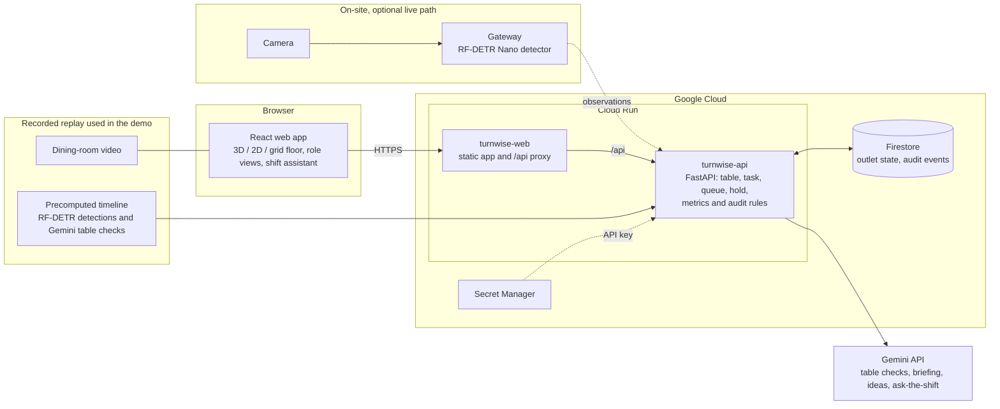

# TurnWise

**Live demo: https://turnwise-web-478369354165.asia-southeast1.run.app**

No sign-in needed. Open the link and click **Watch the live demo**.

TurnWise is an AI operations assistant for casual-dining restaurants. It turns the cameras a restaurant already has into a live table board, a clearing queue and seating recommendations, so a party that leaves is replaced by the next waiting party sooner. Built for the AI Builder Cup, Retail & Commerce track.

## The problem

During a busy service, a host and floor staff have to notice that a party has left, tell someone to clear the table, confirm it is clean, and match it to a waiting party. When that runs on repeated floor checks and shouted updates, a table sits idle while guests wait at the door. TurnWise gives the host, the floor staff and the manager one shared, current view, and measures how long each handoff takes.

## What to try (about 3 minutes)

1. **Landing page.** Scroll the walkthrough. It follows one table through a full turn: guests leave, the table is cleared, it is marked ready, the next party is seated.
2. **Watch the live demo.** This opens a recorded dining-room video with each table outlined, next to the floor plan of the same room.
   - **Autoplay walkthrough** plays the shift hands-free, with captions, while an autopilot acts as host and staff.
   - **Guided** pauses on each camera or Gemini event so you do the job yourself.
   - You can switch between the two while it plays.
3. **Switch role.** Use the persona switcher in the header to act as **Host**, **Floor staff** or **Manager**. Each role sees different next steps.
4. **Change the floor view.** Switch between a 3D model, a 2D plan and a plain grid.
5. **Ask the shift assistant.** Type, or hold to talk, and have the answer read aloud. If it proposes an action, such as seating a party, nothing happens until you confirm it on the card.
6. **Manager view.** Read the Gemini shift briefing and efficiency ideas, and ask questions about the shift.

The first load can take a few seconds while the service wakes up. Every browser tab gets its own isolated demo session, so you cannot affect other judges.

## What it does

| Who | What TurnWise gives them |
| --- | --- |
| **Host** | A waitlist and a ranked seating recommendation with the evidence behind it. A 60-second hold keeps a table while the party walks over. Skipping an older party needs a reason. |
| **Floor staff** | One clearing queue, ordered so the table that can seat the oldest compatible waiting party comes first. They confirm departures and readiness, so a person always has the final say. |
| **Manager** | Shift metrics from departure to ready, ready to seated, and queue wait by party size. Also correction rates, an audit log, a CSV export, and a Gemini shift briefing, efficiency ideas and ask-the-shift. |

**Cameras suggest, people confirm.** Vision only requests a *departure review* after 30 seconds of continuous empty-table evidence. A staff member confirms before the table is released, so an active party is never given away by mistake. Tables the camera cannot see stay manual.

## Where Gemini is used

- **Table checks** on camera frames, saved in the replay timeline and shown as events in the guided demo.
- **Shift briefing** that summarises the last shift for the manager.
- **Efficiency ideas** drawn from the measured handoff times.
- **Ask-the-shift and the shift assistant**, which answer questions about the live board.

## User flow

## System architecture

How the pieces fit:

- **Browser.** A React and Vite app. The role views, floor model and shift assistant all read the same board from the API.
- **Cloud Run.** Two services. `turnwise-web` serves the app and forwards `/api` to `turnwise-api`. The API holds the outlet state and applies the rules for tables, tasks, the waitlist, holds, metrics and audit events. It runs as a single instance, so there is one writer.
- **Firestore.** Stores the outlet, its tables, sessions, parties, tasks, holds and audit events.
- **Gemini.** Called from the API, with fallback across several Flash models. If every model is over quota the app shows a "Gemini is busy" message and the rest keeps working.
- **Recorded replay.** The judge demo plays a stock dining-room video (Mixkit 4385). Its timeline of detections, smoothed table states and Gemini table checks was computed ahead of time and runs through the same observation rules as live data. Each tab gets an isolated session, so nothing touches the live outlet.
- **Live camera path.** Cameras are processed on site by an RF-DETR Nano detector, which sends summaries to the API. It is not part of the judge demo, and it is switched off on the deployed service.

## Built with

Google Cloud Run, Firestore and Secret Manager; Gemini; React, Vite, TypeScript and the Vercel AI SDK on the front end; Python and FastAPI on the back end; RF-DETR Nano for detecting guests at tables.

## More

- [Product requirements](docs/Restaurant_Table_Operations_PRD.md): the problem, users, scope and success metrics.
