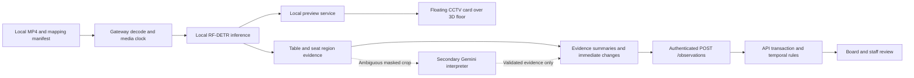

**Task C implementation plan: object detection on prerecorded video**

Prepared 14 October 2026. Status: researched implementation proposal; no detector has been installed, trained, or benchmarked in this workspace.

Build the first version on this Mac using the selected [restaurant CCTV MP4](../backend/recordings/restaurant-cctv-sample.mp4). Run object detection during normal-speed playback, show annotated boxes and mapped table regions in a floating CCTV card over the 3D floor view, and send visual evidence to TurnWise. Position the card in the upper-right corner of the available floor area so it feels like an active monitoring dashboard. Use the existing staff workflow to confirm departure and readiness. Webcam and RTSP are later extensions.

**Selected footage for the initial prototype.**

| Item | Selected value |
| --- | --- |
| Source | [Restaurant CCTV sample by anuj1611](https://github.com/anuj1611/ai-restaurant-cctv-monitoring/blob/main/sample%20video.mp4) |
| Local video | `backend/recordings/restaurant-cctv-sample.mp4` — copied into the workspace and excluded from Git. |
| Reference image | [Local reference PNG](../backend/recordings/restaurant-cctv-reference.png), also excluded from Git. |
| Measured media | 59.08 seconds, 848×480 pixels, 25 FPS, H.264 video, AAC audio, 9,538,805 bytes. Ignore audio during processing. |
| File SHA-256 | `46cf90103df87b55cba04d7aa4af0963765d0b67ff5d1cfd3567fb0dfb0b69b3` |
| Initial use | Local detection, table-region mapping and board-integration prototype using 1x recorded replay. |

The repository reference image shows an elevated corner view of a busy dining room with multiple tables, seated guests and an aisle. Its dimensions are 1910×979, which differ from the video; draw and validate mapping polygons on an actual decoded 848×480 video frame. Use the PNG only as a visual reference. Inspect the complete clip for camera movement, usable visibility and departure events during the first implementation milestone. The clip is selected for the prototype; it is not yet a labelled departure-evaluation set. Footage reuse terms remain unspecified, so training and redistribution require a separate rights check.

Start with Roboflow RF-DETR Nano, compare Small if Nano misses relevant objects, and evaluate restaurant-specific models on the same held-out footage. The model choice is provisional until the Mac benchmark and table-level accuracy checks pass. Keep Gemini as a bounded secondary interpretation step for selected ambiguous crops to retain the original assignment's Gemini schema deliverable.

**What the current repository provides.**

| Area | Current implementation | Required work |
| --- | --- | --- |
| [Gateway entrypoint](../backend/turnwise/gateway/__main__.py) and [ports](../backend/turnwise/gateway/ports.py) | Entry point exits; frame/source/masking/publishing interfaces exist. | MP4 source, media timestamps, mapping, masking, playback, preview and publisher. |
| [Worker ports](../backend/turnwise/worker/ports.py) and [HTTP shell](../backend/turnwise/worker/main.py) | VisualEvidence/interpreter interfaces and health endpoint. | Detector adapter, table evidence aggregation and secondary Gemini interpretation. |
| [Observation router](../backend/turnwise/api/routers/observations.py) | Empty router. | Authorized ingestion of detector-service evidence. |
| [Contracts](../backend/turnwise/contracts.py) | Observation exists, but lacks source/configuration/sequence/reason fields needed by the pipeline. | Complete observation envelope and additive board evidence summary. |
| [Repository](../backend/turnwise/domain/repository.py) | Transactional in-memory tables, sessions, tasks, events and idempotency. | Observation persistence, ordering checkpoints and per-session vacancy state; coordinate with A's Firestore work. |
| [Table operations](../backend/turnwise/domain/tables.py) and [roles](../backend/turnwise/domain/roles.py) | Review, dismissal, departure confirmation and clearing workflow work. SYSTEM can request review; MODEL cannot change operational state. | Connect deterministic temporal rules while preserving these permissions. |
| [Seed](../backend/turnwise/domain/seed.py) | All tables have no camera mapping or observation time. | Dedicated replay fixture for an occupied table; do not use pre-seeded review T3 as evidence the detector works. |
| [Evidence UI](../apps/web/src/features/evidence/Evidence.tsx) | Honest placeholders; existing staff controls can handle review. | Coordinate evidence, uncertainty and recorded-video labels with B. |

The existing backend suite passed 39 tests during the preceding codebase review. Those tests cover the manual foundation, not this proposed vision pipeline.

**Roboflow candidates researched.** Dataset counts and model identifiers below are what the public pages displayed when reviewed. These are candidates, not validated TurnWise results.

| Candidate | Verified information | Proposed use |
| --- | --- | --- |
| [RF-DETR Nano / Small](https://rfdetr.roboflow.com/latest/learn/run/detection/) | COCO-pretrained object detectors; core Nano through Large models are listed under Apache 2.0. | First local baseline for people and visible objects; choose the smallest model that passes our footage benchmark. |
| [Clean Table — Rohith](https://universe.roboflow.com/rohith-vr9nb/clean-table) | 857 images; displayed model `clean-table/4`; object detection classes `occupied`, `unoccupied_clean`, `unoccupied_dirty`; dataset page lists CC BY 4.0. | Closest public table-appearance baseline. Benchmark against RF-DETR plus table-region rules. |
| [Restaurant Tables — Insper](https://universe.roboflow.com/insper-erh3j/restaurant-tables-ymr9k) | 1,544 images; displayed model `restaurant-tables-ymr9k/4`; 29 classes including people, table, cup, bag and plate of food; dataset page lists CC BY 4.0. | Candidate for tableware and belongings evidence or compatible additional training data. |
| [Restaurant-FOH-V1](https://universe.roboflow.com/fyp-0xnal/restaurant-foh-v1-knsgk) | Project shows 1,945 images; displayed model `/6` references an 816-image dataset. Includes occupied/clean/dirty table classes and customer; dataset page lists CC BY 4.0. | Secondary benchmark candidate. Its unrelated classes need not enter TurnWise. |

The public models classify bounding boxes, even where labels describe table appearance. An `unoccupied_clean` prediction can contribute visual evidence; it cannot set TurnWise's operational state to `ready`. Published model metrics use their own datasets and do not establish accuracy on our camera view. Dataset availability also does not establish downloadable weights or the ability to run a particular public model locally; verify access and attribution before adopting it.

The pretrained RF-DETR [class map](https://github.com/roboflow/rf-detr/blob/develop/src/rfdetr/assets/coco_classes.py) contains people, chairs, dining tables, cups, bowls and some belongings. It does not contain generic `plate`, `dirty`, `vacant` or `ready` classes. Empty-plate detection may require restaurant-specific fine-tuning. Read class names from the selected checkpoint instead of hardcoding numeric IDs from an unrelated version.

**Recommended runtime and architecture.**

Use one local inference runtime: `inference-models`, with Supervision for annotations/regions and one compatible OpenCV distribution for decoding and preview. Isolate vision dependencies in an optional backend dependency group so API-only development stays light. Pin compatible versions after a Python 3.12 smoke test; the [installation documentation](https://inference-models.roboflow.com/getting-started/installation/) includes that Python version.

Roboflow documents macOS CPU support and experimental RF-DETR acceleration through Apple MPS. If this Mac supports MPS, explicitly select and benchmark it; otherwise use CPU and report the measured speed. Do not transfer NVIDIA benchmark FPS to this Mac. See [hardware compatibility](https://inference-models.roboflow.com/getting-started/hardware-compatibility/) and Roboflow's [Apple benchmarking guidance](https://rfdetr.roboflow.com/latest/cookbooks/export-apple/).

The first implementation needs a recorded-file reader, not a streaming server. Roboflow's [InferencePipeline](https://docs.roboflow.com/reference/inference/inference-python/inference-pipeline) supports video files, webcams and RTSP; reconsider it when live-source reconnect handling is needed. Avoid introducing both runtimes in the MP4 prototype.

Runtime preflight during footage inspection found that the installed Homebrew ffmpeg/ffprobe binaries cannot start because `libx265.215.dylib` is missing. Mac AVFoundation read the candidate's metadata, but frame extraction also failed in this session. Verify actual decoding through the chosen OpenCV/runtime before relying on this clip or the installed conversion tools; no system packages were repaired as part of the footage search.



The gateway owns video acquisition, replay timing, local masking and publication. The worker package owns reusable inference and evidence interpretation code, called locally by the gateway for this milestone. Only the API-owned domain service changes table state. Do not call `build_services()` in the detector process: it would create another in-memory outlet invisible to the API.

The browser preview is now part of the requested scope. Reuse the existing worker HTTP shell for a local annotated-frame preview, with the replay loop and latest-frame buffer in that same vision process. Proxy its preview routes through the web development server. The API continues to receive observation metadata and own operational state; it does not need to relay every video frame. The floating panel consumes the actual processed replay frames, independently of board polling.

This proposal deliberately changes the [PRD](Restaurant_Table_Operations_PRD.md): `/observations` currently describes frame ingestion followed by cloud interpretation; the detector-first design accepts metadata from an authenticated local vision service. Agree that revised request contract with A before implementation and update the PRD when adopted. The route is currently empty, so there is no implemented observation client to migrate. Keep raw video local; any selected image sent to Gemini must be masked first.

**Implementation milestones, in delivery order.**

1. **Prove local detection on the selected CCTV MP4.** Add the vision dependency group and a small runner using the existing gateway entrypoint. Decode `backend/recordings/restaurant-cctv-sample.mp4`, inspect the whole 59.08-second clip, run RF-DETR Nano, and display boxes, class labels, media time, model version and measured inference FPS. Handle unreadable files, decode failures and end-of-file explicitly. Benchmark Nano before comparing Small. Exit: a repeatable local run, a recorded speed/detection baseline, and annotated clip intervals identifying which temporal tests the footage can actually support; no API integration required yet.

2. **Map detections to tables.** Add a manifest containing recording/session ID, source dimensions, table ID, authoritative camera ID, tabletop polygon, seat-area polygons and configuration version. Use fixed mappings for table identity. Associate people with seat areas and objects with tabletops. Calibrate anchor/overlap behavior against the actual view, including boundary ambiguity between adjacent tables. Add deterministic per-table evidence aggregation. Exit: annotated footage clearly explains which evidence belongs to each table and exposes uncertain cases.

3. **Agree contracts and implement backend rules with A.** Extend the existing Observation model, repository and Services; add `domain/observations.py`. Complete authenticated `/observations` with request validation, content-aware idempotency, sequence/configuration checks and atomic evidence/rule/event writes. Use FakeClock tests before wiring real detector output. Exit: controlled observation sequences produce exactly one review after the time threshold and never create clearing work automatically.

4. **Connect the selected replay to the API and B's floor UI.** Publish normal-speed CCTV replay evidence into a deliberately mapped demo session, initializing operational state manually to match the selected table's starting condition. Extend the shared `entry_for` response so board GET and action responses carry identical evidence fields. C provides annotated preview frames and run metadata; B adds the floating CCTV card specified below, fills the existing evidence panel, and adds source, freshness, uncertainty and review attribution. Exit: the selected MP4 plays above the 3D floor and updates the correct tables and source/freshness labels; a verified qualifying departure or a separately labelled synthetic observation test exercises review, staff confirmation, exactly one task and the existing Claim/Start/Ready flow. Do not claim the video proves a departure if its inspected content does not contain one.

5. **Retain the Gemini schema deliverable as a secondary path.** Implement a strict, versioned VisualEvidence schema for selected ambiguous masked crops. Limit request frequency, timeouts and retries. Gemini may explain objects or ambiguity; it cannot establish missing video coverage, release ownership, or authorize readiness. Late results must pass the same capture/session/configuration checks. Exit: schema/failure tests pass and the main replay still works when Gemini is unavailable. A detector-only final delivery would require the team to explicitly revise the original Gemini requirement.

6. **Evaluate and fine-tune only where needed.** Compare the selected baseline and accessible restaurant-specific candidates on held-out recording sessions. Fine-tune one model if camera-specific misses justify it; keep detector and rule evaluation separate. Produce a reproducible report, failure examples and final model/version choice. Exit: complete scripted exceptions, measured quality and latency, and documented limits. Start recording and labelling footage in parallel with milestones 1–3.

**UI design: floating CCTV above the 3D floor.**

Keep the 3D floor as the main workspace. Place one compact, elevated CCTV card over the upper-right corner of its available area. The card stays visible while the host or staff member selects tables, so the moving footage and operational floor board can be read together. Preserve a visible `Recorded replay · 1x` badge; the continuous playback and current frame information provide the real-time feel.

```text
TurnWise | Host / Staff / Manager                    Demo data | Identity
-----------------------------------------------------------------------
| Ledger          |                 Floor lenses                      |
|                 |                          +----------------------+ |
| Table list      |                          | CCTV 01   Replay 1x  | |
|                 |                          |                      | |
| Clearing queue  |      3D floor model       | Moving CCTV footage  | |
|                 |      and table tags      | + detection boxes    | |
|                 |                          | 00:18 / 00:59        | |
|                 |                          | Processing  Frame age| |
|                 |                          +----------------------+ |
|                 |                                                   |
|                 |    Illustrative layout note          Grid view    |
-----------------------------------------------------------------------
```

The diagram shows placement, not camera data or detection results. When the inspector is open, it occupies the far-right column and the CCTV card moves left into the remaining floor area.

| Design decision | Initial specification |
| --- | --- |
| Desktop anchor | Upper-right of the available floor area, below the lens controls. Use an initial 72px top offset and 16px margin from the available right edge. Calculate that edge from the same inspector inset already passed by FloorApp to Stage. |
| Card size | About 320px wide, maximum 360px; preserve the selected video's 848:480 aspect ratio with `object-fit: contain`. Use a compact approximately 200px-wide version when the available floor width is below 600px. |
| Panel appearance | Reuse the app's white surface, rule border, 14px panel radius, existing floating shadow, typography and house Button/Dialog components. A dark video surface provides contrast for annotation labels. |
| Header | Camera icon, `CCTV 01`, `Recorded replay · 1x`, and labelled Minimize / Expand controls. Camera name and mapping come from the configured source. |
| Video overlay | Actual detector boxes and supported class labels, configured table-region IDs, and media elapsed time. Keep annotations restrained; do not invent boxes, confidence or table mappings to make the video appear active. |
| Footer | Processing status, last processed-frame age and measured FPS. Use words with the status dot so quality does not depend on color. Show Ready to start, Starting, Processing, Video ended or Unavailable as appropriate. |
| Inspector behavior | Move the card with the inspector inset; keep table inspection and staff actions unobstructed. The preview's visibility never changes ownership or operational state. |
| Floor framing | Use the existing camera Insets/framePose support to keep the floor and selected table visible around the expanded card. If the viewport becomes too constrained, use the compact card. Do not add a general-purpose floating-window layout system. |
| Tablet / phone | Use the compact preview inside the floor area below lens controls. When it would obscure the selected table or essential controls, collapse it to a labelled CCTV button; expand through the existing Dialog. |
| Grid fallback | Keep the preview available with the table grid, reserving space above the grid so cells remain visible and selectable. |
| Motion and access | Smooth opacity/position changes only when layout changes; honor reduced-motion preference. Controls must be keyboard accessible, Escape closes the expanded Dialog, and focus returns to its trigger. Provide a textual camera/evidence summary alongside the imagery. |

Mount the card as a DOM overlay beside Stage in [FloorApp](../apps/web/src/routes/FloorApp.tsx), rather than as a texture inside the Three.js scene. The current [Stage](../apps/web/src/features/floor-scene/Stage.tsx) places the Grid/Floor toggle at the bottom-right, and FloorApp places the layout note near the bottom; the upper-right anchor avoids those controls. Keep the video outside the demand-rendered canvas so frame updates do not force the entire 3D scene to redraw. Use existing responsive layout helpers and inspector offsets rather than introducing a new docking library. Dragging and arbitrary resizing are outside the first version.

C owns the preview source and synchronization; B owns the floating component and responsive placement. The first transport can be a local MJPEG endpoint, `GET /preview/cameras/{camera_id}/stream`, emitting the latest annotated JPEG at the actual processed-frame cadence. A companion `GET /preview/cameras/{camera_id}` supplies run ID, source mode, media offset/duration, latest frame capture time, measured FPS and processing status. Configure the development proxy so the browser uses same-origin `/preview/...` URLs. Keep these routes on the local vision service for this Mac prototype; production authentication/hosting follows the deployment plan.

Use a single latest-frame slot, drop obsolete frames under backpressure, and release subscribers on disconnect. Burn the frame's media timestamp into its annotation so displayed boxes and time belong to that same processed image. Do not promise 25 FPS merely because the input is 25 FPS: show measured output FPS and use the existing processing benchmark. The HTTP shell and replay loop must share the same frame slot; a separately launched worker with an independent store would not display the gateway's frames.

Minimizing or opening the inspector leaves the replay and inference running. At EOF, stop advancing the clock and show Video ended; restarting from the local replay runner creates a new run and clears prior evidence windows through the existing reset rules. The first panel has only Minimize/Expand controls; browser playback/restart controls can follow when run-control permissions and session reset behavior are implemented. If frames stop or the preview service disconnects, show Unavailable or Waiting for frames and the actual last-frame age. A frozen image must not retain a fresh Processing indicator. Preview freshness and API/board freshness remain separate. Audio stays disabled. The 3D floor positions remain labelled illustrative until calibrated physical coordinates are supplied; shared table IDs connect the footage to the board.

**How detections become trustworthy table evidence.** These are proposed TurnWise policies, not capabilities guaranteed by Roboflow.

| Input condition | Evidence policy |
| --- | --- |
| Credible person detection inside a calibrated seat region | Interrupt vacancy immediately; report occupied or unclear if table association is ambiguous. |
| Person passing in an aisle | Exclude from seated-person counts; treat actual obstruction of a seat view as uncertainty. |
| No people detected with successful inference and verified usable seat coverage | Candidate vacancy, subject to temporal continuity and held-out false-negative evaluation. |
| No people detected with a blocked view, decode/inference failure, invalid mapping or missing coverage | Unclear. A successful empty detection response alone is insufficient to prove vacancy. |
| Cup, bowl, plate or other tabletop object | Record supported object flags. Object presence does not prove departure, dirtiness or hygiene. |
| Belongings remain | Mark review evidence uncertain and retain ownership until staff confirm. |
| Camera/view moves or source dimensions change | Invalidate the mapping and require recalibration before automated evidence resumes. |

Define a testable coverage gate: validated static mapping, current decoded frame, successful inference, supported dimensions, adequate visibility and checks for unusable/obstructed input. Calibrate brightness/blur/occlusion limits from footage instead of claiming that a generic detector provides an occlusion score. Ambiguous visibility remains unclear. An undetected person can still pass such checks, so false vacancy must be measured and staff confirmation remains mandatory.

Supervision's [PolygonZone](https://supervision.roboflow.com/latest/detection/tools/polygon_zone/) defaults to a bottom-center anchor; anchor membership is not full bounding-box overlap. Seated people need seat-area calibration, since their box anchor may lie outside a tabletop polygon. Start without tracking. Add a temporary tracker only if tests show improved association or fewer false interruptions; predicted tracks must expire and must never become party/customer identity. Use the API matching the pinned package version rather than older tutorial snippets.

**Replay timing and operational timing must be explicit.**

- First demo: forward-only playback at 1x speed. Input is a local MP4; preview is visibly labelled recorded replay. Use media presentation timestamps, not inference completion time, for elapsed evidence duration. Validate timestamp monotonicity; normalize unsupported/irregular input with the existing ffmpeg/ffprobe tools when necessary while preserving the original file.
- At replay start, map clip time onto UTC once: `observed_at = replay_started_at + (media_timestamp - first_media_timestamp)`. Retain original recording ID and media offset. Processing lag must not be hidden by replacing old capture times with the current wall clock.
- Proposed initial target: at least 5 processed frames per second for one camera, with P95 processed-frame age below 2 seconds during normal playback. These are benchmark gates, not achieved performance. Detect more slowly only with an explicit revised target and measured effect on misses/delay.
- Bound the live-paced playback buffer; drop obsolete pending frames instead of accumulating lag. Record dropped samples. A processed-frame gap over the initial 2-second coverage limit interrupts vacancy continuity; tune this limit on development footage and freeze it for evaluation.
- Publish an initial observation at the first valid frame, then a summary every 10 seconds of media time, plus immediate occupied/unclear changes. Summaries include any occupied/unclear interruption during the interval. A guest appearing at 14 seconds and leaving at 17 seconds must still interrupt the summary ending at 20 seconds.
- Count distinct accepted summaries spanning at least 30 seconds, not individual high-FPS frames. At a 10-second summary cadence, evidence at 0, 10 and 20 seconds is insufficient; the regular sequence first qualifies at 30 seconds.
- Stopping or reaching EOF stops fresh evidence. An idle publisher must not refresh observation times. The backend marks evidence stale after more than 60 seconds since the last reliable capture, preserving party and operational state. Restart/seek begins a new replay run with a reset test session; pause/seek controls are outside the first demo.
- Offline evaluation uses deterministic sampling and an injected media clock, without real-time frame dropping or wall-clock sleeps. Report skipped/failed frames explicitly. Never send accelerated evaluation timestamps into the normal live API; use isolated test services. Recording playback speed must not change the measured 30-second rule.

**The proposed observation envelope reuses the existing contract.** Final field names should be agreed with A before coding.

| Group | Fields / ownership |
| --- | --- |
| Routing and identity | `observation_id`, `frame_id`, `outlet_id`, `camera_id`, `table_id`, `configuration_version`; validate against the authenticated source and stored mapping. |
| Ordering | `stream_id` for the replay run and monotonic `gateway_sequence`; register/reset source generation explicitly so delayed previous runs cannot become current again. |
| Timing and coverage | `interval_started_at`, `observed_at`, `continuous_valid_coverage`, `occupied_seen`, `unclear_seen`; the gateway summarizes all processed evidence during the interval. |
| Visual evidence | Existing `visual_status`, `object_flags`, `occlusion`, plus bounded `reason` and explicit uncertainty reasons. |
| Provenance | `source_mode=replay`, recording ID/media offset, detector checkpoint/model version, evidence-policy version; `prompt_version` only when Gemini contributed. |
| Server-owned values | `received_at`, accepted session association, effective freshness, operational transition and audit event. |

Use a gateway service credential scoped to the outlet/camera; do not let frontend users supply a SYSTEM actor. For local development, a server-side token configured separately from human actor headers is sufficient until A supplies service authentication. Bind the API locally during this stage. Use content fingerprints for idempotency and retain stable IDs across retries.

Validate aware timestamps, bounded future skew, age, interval order, matching mapping, sequence and source generation. Reject intervals crossing the current session or a staff-dismissal/manual-correction reset boundary. Duplicate deliveries must not increase the count. Missing or interrupted coverage resets continuity even if the next endpoint frame is vacant. Persist checkpoints and evidence with the session/audit transition in one repository transaction.

Only qualify automatic review while the table is occupied, the active session is valid and a manual occupied override is not locking it. Reset vacancy after dismissal, new seating, stale gaps, mapping/source changes and applicable overrides. Fresh returning-guest evidence should resolve only an observation-created review through a narrowly scoped deterministic rule; coordinate that permission with A. It must preserve ownership and create no task. Fresh occupancy on a ready/held table raises a verification blocker for A's recommendation/hold logic.

Keep freshness independent from operational state: latest unclear evidence immediately blocks automatic eligibility, and repeated unclear results do not extend `last_valid_observation_at`. Derive staleness on server reads/eligibility checks so silence is detected; record `camera_stale` once per outage using a small scheduled domain check. Avoid incrementing operational `state_version` for every harmless evidence update. B must display camera freshness separately from API connectivity.

**Files and ownership affected.** Names marked new are proposed files, not existing implementations.

| Owner | Files | Purpose |
| --- | --- | --- |
| C | `backend/turnwise/gateway/__main__.py`, `ports.py`; new `replay.py` and `publisher.py` | MP4 runner, mapping/media clock, annotated preview, bounded evidence delivery. |
| C | `backend/turnwise/worker/ports.py`, `main.py`; new `detector.py`, `evidence.py`, `gemini.py` | One detector adapter, table-region aggregation, secondary structured interpretation, and annotated preview/metadata routes in the existing HTTP shell. Keep the replay loop and preview frame buffer in the same vision process. |
| C + A | `backend/turnwise/contracts.py`, `api/routers/observations.py`, `api/deps.py` | Shared observation/board schema, gateway authentication and ingestion. |
| C + A | new `domain/observations.py`; existing `repository.py`, `services.py`, `tables.py`, `context.py`, `board.py` | Persistence, freshness, temporal rules, provenance, reset hooks and consistent board/action responses. A implements matching Firestore behavior. |
| C | `backend/tests/` and new `backend/tests/fixtures/vision/` | Small synthetic/permitted fixtures, fake detector, domain/API/replay/schema tests. |
| C | new `backend/scripts/evaluate_vision.py` and `docs/Task_C_Vision_Evaluation.md` | Repeatable scoring and evidence report after actual runs. |
| C | `backend/pyproject.toml`, environment example, lockfile, `.gitignore`, README | Optional vision dependencies, model/source settings, ignored recordings/weights/secrets, run instructions. |
| B, with C contract support | New `apps/web/src/features/evidence/CctvPreview.tsx`; `routes/FloorApp.tsx`, `features/floor-scene/Stage.tsx`, `lib/api/types.ts`, existing evidence components, camera lens/manager exceptions, landing sample and `vite.config.ts` | Floating CCTV panel, responsive placement and inset coordination, preview proxy, observation age, status/uncertainty, correct source attribution and recorded-replay label. |

The current evidence component labels departure checks as Staff; B must use server provenance for detector-created reviews. The API currently reports board freshness from HTTP delivery; a working API does not establish fresh video. All action responses must carry the additive evidence fields because the frontend replaces the whole table entry after a mutation.

**Footage, training and evaluation deliverables.**

Use staged or consented recordings showing the full table-and-seat view. First collect a small functional set covering final departure, brief absence, guests returning, aisle passers, blocked seats, belongings, used dishes, poor lighting, adjacent tables and video ending. Retain event labels for independently observed final departures, separate from staff-confirmation timestamps.

For fine-tuning, use object boxes with a consistent class set supported by our task; do not mix person/people/customer labels without an explicit mapping. Include empty plates only when they are actually annotated. For workflow scoring, use timestamped table occupancy/visibility intervals and departure events. Ground-truth labels stay outside inference inputs. Split training/development/test sets by recording session before extracting frames or augmenting them; adjacent video frames must not cross the split. Inspect public dataset provenance and split quality before mixing it with local footage.

| Report item | Required evidence |
| --- | --- |
| Model and runtime | Model/checkpoint, dataset version, package versions, Mac hardware/OS, execution device, input/model resolution, thresholds and policy version. |
| Object quality | Per-class counts, precision/recall and mAP where object boxes are labelled; include missed small tableware and seated people. |
| Table quality | Occupied/vacant precision and recall, unclear rate/reasons, per-table/session breakdown and occlusion/temporary-absence failures. |
| Review quality | Final-departure review precision/recall, false reviews, missed departures and delay from human-labelled final departure. Do not score every frame as an independent departure event. |
| Speed | Warm-up excluded from steady-state FPS but reported separately; P50/P95 inference and capture-to-board latency, frame age, dropped frames and memory. Distinguish media-time event delay from wall-clock processing cost. |
| Coverage | Recording sessions, complete cycles, class/scenario counts, exclusions and missing/censored events. The PRD proposes 100 complete cycles across at least five sessions; a smaller functional demo must state its actual coverage. |

The PRD's proposed quality goals are occupied precision at least 95%, occupied recall at least 90%, and departure-review precision at least 90%, with missed departures reported. Its capture-to-board P95 target is under 15 seconds at the intended 20-table/2-camera load. Measure the initial one-video prototype separately; do not claim full-load or restaurant-wide performance from it. The independent 30-second vacancy interval remains in force.

Keep full videos local and excluded from Git. Mask faces and unrelated areas before cloud interpretation or sharing annotated examples; reject a crop if required masking cannot be applied. Store metadata by default, delete transient images after use, and preserve the PRD's maximum 10-minute retry buffer. An optional stored evidence image needs its own authorized retention/deletion path; it is unnecessary for the first local preview.

**Acceptance checklist for the implementation.**

- [ ] MP4 plays on this Mac with real detector boxes, calibrated table regions, source label and measured speed.
- [ ] Floating CCTV card appears above the 3D floor in the available upper-right corner and shifts when the inspector opens.
- [ ] At desktop, tablet and phone widths, the preview does not hide table selection, staff actions, lens controls or the Grid/Floor toggle.
- [ ] Minimize/Expand controls, keyboard navigation, Dialog focus behavior and reduced-motion handling work; inference continues while the preview is minimized.
- [ ] The displayed footage, annotations and media clock come from the same processed frames; recorded source, measured FPS and actual frame age remain visible.
- [ ] EOF, decoder failure and preview disconnect show accurate status; a restart through the local runner starts a fresh run without carrying previous vacancy evidence.
- [ ] Aisle passers, ambiguous table associations and unsupported classes are handled explicitly.
- [ ] Empty detector output, inference failure and occlusion cannot independently authorize vacancy or readiness.
- [ ] Three rapid frames and summaries at 0/10/20 seconds do not request review; a valid 0/10/20/30 sequence does once.
- [ ] A person appearing and disappearing between summaries interrupts vacancy.
- [ ] Duplicate/reordered delivery, changed content under one key, previous source runs and old mappings cannot corrupt current evidence.
- [ ] Staff dismissal/override and new seating invalidate preceding vacancy intervals, including delayed results.
- [ ] Camera/video silence becomes stale after more than 60 seconds without releasing party ownership; recovery starts new continuous evidence.
- [ ] Guest return during a detector-created review creates no clearing task.
- [ ] Replay -> departure review -> staff confirmation creates exactly one clearing task; existing Claim/Start/Ready still passes.
- [ ] Gemini schema, timeout, malformed-response and stale-result tests pass; its absence does not stop local detection.
- [ ] Boundary tests cover exactly 30 seconds, exactly 60 seconds and immediately beyond each threshold using FakeClock.
- [ ] Evaluation uses fixed held-out recording sessions and deterministic media timing, with failures/drops/unclear samples reported.
- [ ] Existing backend tests and Ruff pass; B runs web typecheck/build and checks evidence/recorded-mode rendering after integration.

**Online footage shortlist, researched 14 October 2026.**

The restaurant CCTV sample below is selected for the first prototype and saved at the local path specified above. Its repository-provided reference image and downloaded MP4 metadata were inspected; full clip playback, camera stability and departure events remain unverified. The stock alternatives are optional supplementary footage. Keep the original source URL and applicable license with any local fixture.

| Footage | Verified metadata | Proposed use and limitation |
| --- | --- | --- |
| [Restaurant CCTV sample MP4](https://github.com/anuj1611/ai-restaurant-cctv-monitoring/blob/main/sample%20video.mp4) and [reference image](https://github.com/anuj1611/ai-restaurant-cctv-monitoring/blob/main/sample.png) | Measured locally: 59.08 seconds, 848×480, 25 FPS, approximately 9.1 MB; MP4 contains H.264 video and AAC audio. GitHub provides a Raw download. | Best angle match found: elevated corner dining-room view with multiple occupied tables. Start with people/seat occupancy; 480p and occlusion may limit small-object detection. Footage provenance and reuse license are unspecified; no LICENSE file was visible in the repository. Confirm permission before training or redistributing it. |
| [Lively Indoor Food Court Gathering — Pexels](https://www.pexels.com/video/lively-indoor-food-court-gathering-34710736/) | 19 seconds; 1920×1080; 59.94 FPS; page describes a crowded indoor food court and offers Free download. | Alternative for detecting people in a busy dining scene. Inspect table visibility and camera motion before assigning fixed table polygons. Too short for the 30-second rule. |
| [Coffee Shop Restaurant Full of Customers — Pexels](https://www.pexels.com/video/a-coffee-shop-restaurant-full-of-customers-3135924/) | 10 seconds; 1920×1080; 29.97 FPS; Free download. | Busy café alternative for people detection and overlapping patrons; too short for departure timing. |
| [Customers in a Minimalist-Style Restaurant — Mixkit](https://mixkit.co/free-stock-video/customers-in-a-minimalist-style-restaurant-4385/) | 15 seconds; 1920×1080 offered; 24 FPS; high-angle dining-room description; Stock Video Free License. | Useful candidate for multiple table regions, diners and passing waiters. Explicitly tagged time lapse, so its media seconds cannot be assumed to represent real elapsed service time. |
| [Lunch, Meal, People — Pixabay](https://pixabay.com/videos/lunch-meal-people-tea-cup-tea-2339/) | 35 seconds on the site's matching video card; 1920×1080 MP4; free download under Pixabay Content License. | Longer people-at-table candidate. Busy-room coverage, camera stability and a sufficiently early departure are unverified. |

For a larger research source, the [official CAFE project](https://dk-kim.github.io/CAFE/) links an approximately 150 GB dataset from six café locations. Its [paper](https://arxiv.org/html/2312.02878v2) describes staged, consented activities and a benchmark of six-second clips derived from longer recordings. Check small-subset access, dataset-specific terms and untrimmed footage availability before choosing it. The website's license does not by itself establish the footage license. This is a secondary research lead rather than the first Mac download.

None of these sources was verified to contain a complete departure followed by at least 30 seconds of continuously visible vacancy. Use short clips to test decoding, object boxes and table association, and the existing proposed FakeClock tests to validate rule logic. Obtain an uninterrupted normal-speed recording for end-to-end timing evaluation. Looping, slowing or joining unrelated clips cannot supply independent evidence of a real departure; reset the replay/session at every discontinuity. Download and machine-learning training rights must be checked for the selected source before using it as training data.

Skipped from the first implementation: webcam/RTSP capture, cloud video transport, draggable/resizable camera windows, model training before a baseline, tracking without measured benefit, and additional deployment infrastructure beyond the existing local worker preview service.
Unverified risks: achievable FPS on this Mac, actual restaurant-view accuracy, public model access/annotation quality, and availability of suitable labelled footage. These remain explicit benchmark and integration gates.
